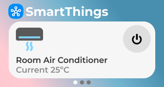
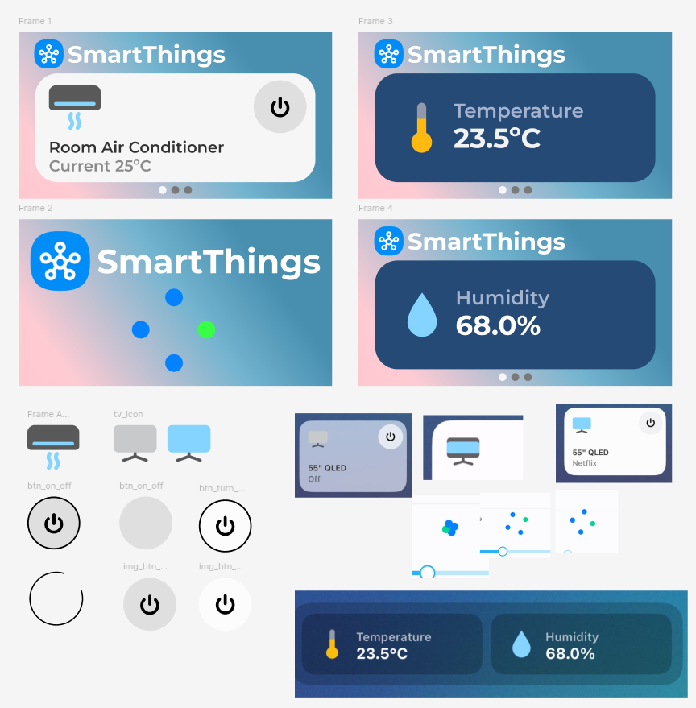

# LVGL ESP32 SmartThings Controller



An LVGL application for controlling Samsung SmartThings devices using Lilygo T-Display S3 and ESP-IDF.

Supported devices: Smart TV and Air Conditioner. Support for other devices can be added.

It also shows average temperature and humidity.

Current status, known issues and the plan for the Waveshare ESP32-C6-Touch-LCD-1.9: [STATUS.md](STATUS.md).

## Design

The design was heavily inspired on the SmartThings iOS app. Assets and prototype were made in Figma and Inkscape.



## UI

The UI is an [LVGL Pro](https://pro.lvgl.io) project in `main/ui/`: open that
folder in the LVGL Pro Editor to change it, then regenerate its C code from the
Editor or the LVGL Pro CLI. `main/ui/README.md` describes it, including how the
UI can run in the Editor's preview with a simulated firmware.

The firmware and the UI only meet in `main/app/app_ui.c`:

- **State, firmware to UI:** the devices and the AC averages are written into
  the UI's subjects (`subject_device<N>_*`, `subject_temperature`,
  `subject_humidity`).
- **Commands, UI to firmware:** the UI calls `ui_devices_set_power()`, and the
  firmware registers what it does with `ui_devices_register_api()`: a
  SmartThings API request in a task.
- **Input:** the button calls `ui_next_page()` (short press) and
  `ui_toggle_current_device()` (long press).

Every call into LVGL from a task other than the LVGL task holds the lock of
`lvgl_port_lock()` / `lvgl_port_unlock()` (`main/display/lvgl_init.h`).

The firmware uses real Wi-Fi and SmartThings requests. The previous
`MOCK_API_DEMO` implementation is replaced by the Editor preview backend in
`main/ui/custom/app_simulator.c`, which registers the same callback API and
updates the same subjects without requiring the ESP32 or network access.
`api_smartthings` handles HTTP and device data; application startup and the
connection to the UI live in `main/main.c` and `main/app/app_ui.c`.

## Requirements

- ESP-IDF v6.0.2. The component manager fetches LVGL 9.5.0 (the version LVGL Pro
  supports) and cJSON.

- Samsung SmartThings API Token

Visit SmartThings website [https://account.smartthings.com/tokens](https://account.smartthings.com/tokens). Login with your samsung account and generate an API token.

- Create .env file

On project root, create `.env` file with WiFi SSID and password, and Samsung SmartThings API token
```
WIFI_SSID="YourSSID"
WIFI_PASSWORD="YourPass"
SMARTTHINGS_API_TOKEN="12345-your-token-here-6789"
```

The root CMakeLists.txt will pick up those values and add to the application.

## Reference commands

- Converting Lottie JSON files to C arrays for the UI: put the JSON in
  `main/ui/custom/lottie_assets/` and run

```
python3 main/ui/scripts/lottie_to_c.py
```

  then add the animation to the table in `main/ui/custom/lottie_assets/lottie_assets.c`
  and its `.c` file to `main/ui/user_config.cmake`.

- Generate certificates for smartthings api
```
openssl s_client -showcerts -connect api.smartthings.com:443 </dev/null | awk '/BEGIN/,/END/{ print $0 }' > main/api/certs/smartthings_root_cert.pem
```
